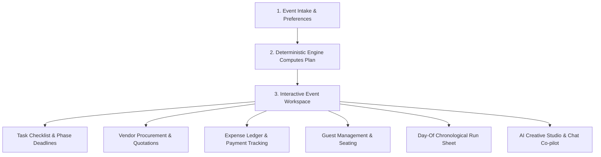

# EventForge — Intelligent Event Planning & Creative Synthesis Platform

> A production-grade, full-stack MERN application combining deterministic planning algorithms with generative AI to orchestrate weddings, milestone birthdays, and community gatherings.

---

## 1. Chosen Vertical: Event Planning & Coordination

### Why Event Planning?
Event coordination represents a complex, multi-variable domain characterized by two distinct challenges:
1. **Rigid Operational Logistics:** Inflexible deadlines, hard financial ceilings, dynamic vendor dependencies, guest dietary constraints, and day-of minute-by-minute execution.
2. **Dynamic Creative Ideation:** Personalized aesthetic themes, decor motifs, personalized activities, and marketing/invitation assets.

Most existing solutions fall into two extremes: generic spreadsheets that lack domain intelligence, or generic chatbots that hallucinate unrealistic budgets and miss hard operational dependencies. 

**EventForge** bridges this divide by focusing on three distinct event archetypes:
* **Weddings:** High complexity, strict budget-to-vendor allocations, multi-month booking lead times, and etiquette-sensitive guest coordination.
* **Milestone Birthdays:** Age-customized entertainment requirements, dietary considerations, and personalized activity pacing.
* **Community Gatherings:** Large crowd scaling, outdoor permit and sanitation logistics, safety protocols, and accessibility compliance.

---

## 2. Approach and Logic

EventForge implements a **Hybrid Intelligence Architecture** that bifurcates operations into deterministic business logic and generative creative synthesis.

```
┌────────────────────────────────────────────────────────┐
│                   Client Interface                     │
│           (React 19 + Vite Responsive SPA)             │
└──────────────────────────┬─────────────────────────────┘
                           │ HTTPS / REST (JWT Bearer)
┌──────────────────────────▼─────────────────────────────┐
│                 Express.js Application                 │
├──────────────────────────┬─────────────────────────────┤
│   Deterministic Engine   │     Generative AI Layer     │
│  • Timeline & Phases     │  • Context-Grounded Chat    │
│  • Proportional Budget   │  • Thematic Concept Studio  │
│  • Vendor Procurement    │  • Vector SVG Poster Design │
│  • Readiness Scoring     │  • Curated Fallback Ideas   │
└────────────┬─────────────┴──────────────┬──────────────┘
             │ Mongoose TLS               │ Server-to-Server
┌────────────▼─────────────┐ ┌────────────▼─────────────┐
│      MongoDB Atlas       │ │  Google Gemini / Claude  │
└──────────────────────────┘ └──────────────────────────┘
```

### 2.1 Deterministic Planning Engine (The Anchor)
Core operational requirements must never depend on non-deterministic LLMs. Critical invariants are calculated via pure algorithmic logic:
* **Proportional Budget Allocation (`splitWhole` Algorithm):** Uses integer-level apportionment based on event category weights, prioritized categories, and setting factors (e.g., automated rental allocations and contingency buffers for outdoor events). The algorithm guarantees that the sum of line items always equals 100% of the budget with zero rounding errors.
* **Dynamic Booking Windows:** Vendor procurement deadlines are calculated backward from the target event date based on industry lead times (e.g., booking venues 9–12 months prior; flagging vendors as `bookNow` when lead times are compressed).
* **Phased Milestone Progression:** Automatically segments task timelines into structured phases (`Foundation`, `Booking`, `Details`, `Final Countdown`, `Day of Event`, and `Post-Event Wrap-up`).
* **Heuristic Readiness Scoring:** Computes real-time KPI readiness metrics by weighting completed checklist tasks, confirmed vendor contracts, budget utilization, and guest RSVP confirmations.

### 2.2 Generative AI Layer (The Creative Multiplier)
Generative AI (Google Gemini 2.5/3 Flash & Anthropic Claude) is layered strictly where creativity and context-aware communication add value:
* **Context-Grounded Event Co-pilot:** The chat assistant receives the real-time financial, vendor, and task state injected into its system instructions, preventing hallucination and delivering advice tailored to current event progress.
* **Thematic Inspiration Engine:** Generates custom concept ideas, styling motifs, and itineraries tailored to the user's specific vibe, budget tier, and guest demographics.
* **AI Poster Studio:** Synthesizes SVG and raster visual event posters dynamically based on event themes and color palettes.

### 2.3 Defense-in-Depth Security Architecture
* **Strict JWT Algorithm Pinning:** Enforces HMAC-SHA256 (`HS256`) and prohibits weak or default development secrets in production mode.
* **Vector SVG Sanitization:** All AI-generated vector posters pass through strict DOM sanitization (`sanitizeSvg`), stripping `<script>`, `<iframe>`, `object`, and inline event attributes (`onload`, `onerror`) to prevent Stored XSS.
* **NoSQL Injection Neutralization:** Input payloads are sanitized against MongoDB operator injection (`$` and `.`).
* **Tiered Rate Limiting:** Differentiates between standard data operations (100 req/min), authentication attempts (15 req/min), and resource-intensive AI generation (10 req/min).

---

## 3. How the Solution Works

### 3.1 End-to-End User Journey



1. **Intake & Initialization:** The user specifies event type, event name, target date, guest count, total budget, currency, setting (indoor/outdoor/hybrid), style vibes, and priorities.
2. **Instant Plan Synthesis:** The backend generates an initial comprehensive blueprint:
   - Itemized budget with contingency buffers.
   - Recommended vendor roster with calculated book-by milestones.
   - Phased checklist of foundational tasks.
3. **Execution Workspace:**
   - **Preparation Dashboard:** Displays real-time KPIs (Budget Utilization %, Vendor Booking %, Task Progress %, Overall Readiness Score).
   - **Task Checklist:** Interactive task tracker supporting custom tasks, priority badges, assignments, and due dates.
   - **Vendor Procurement Ledger:** Tracks vendor statuses (`Researching`, `Contacted`, `Quoted`, `Booked`), contact info, quotation amounts, agreed rates, and paid deposits.
   - **Budget & Expense Ledger:** Compares estimated category costs against actual expenditures with payment due-date reminders.
   - **Guest List & Seating:** Tracks RSVPs, dietary needs, plus-ones, table assignments, and supports batch CSV imports.
   - **Day-Of Run Sheet:** Chronological schedule coordinating setup, activities, and vendor arrivals.
   - **AI Poster Studio & Ideation:** On-demand generation of bespoke visual posters and concept suggestions.
   - **Grounded AI Assistant:** Floating chat assistant capable of answering questions, drafting vendor inquiries, and offering advice informed by the user's live event data.

---

## 4. Key Assumptions Made

1. **Graceful Offline Degradation (Zero Hard Dependency on AI):**
   - The application does not require an active LLM API key to function. If `GEMINI_API_KEY` is not provided or upstream APIs experience rate limits/outages, the application seamlessly switches to curated deterministic idea libraries, allowing all planning, budgeting, task, and vendor features to operate uninterrupted.
2. **Mathematical Precision & Currency Normalization:**
   - Budgets and expenses are represented with exact fractional decimal handling and normalized across six supported currencies (`USD`, `EUR`, `GBP`, `CAD`, `AUD`, `INR`). All allocations are constrained to non-negative whole numbers to prevent fractional penny drift.
3. **User Tenancy & Data Isolation:**
   - Data access is strictly partitioned at the database query level by authenticated `User` ID. A user can only read, mutate, or delete events and sub-resources they explicitly own.
4. **Container & Cloud Network Environment:**
   - The application is assumed to operate behind an SSL-terminating reverse proxy (such as Render or Nginx). The server dynamically binds to `0.0.0.0` on `process.env.PORT` to satisfy container port-binding requirements.
5. **Guest List Scale:**
   - Individual events are designed for scale up to 5,000 guests, with CSV batch imports capped at 500 rows per operation to prevent memory saturation and payload denial-of-service.

---

## 5. Technology Stack

| Layer | Technologies |
| :--- | :--- |
| **Frontend** | React 19, Vite, React Router v7, Lucide Icons, Modular Design Tokens (Pure CSS) |
| **Backend** | Node.js (v22+), Express.js (v5), Mongoose ODM |
| **Database** | MongoDB Atlas (TLS 1.3 encrypted) |
| **Generative AI** | Google Gemini API (`@google/genai`), Anthropic SDK (`@anthropic-ai/sdk`) |
| **Security** | Helmet, Bcrypt.js, JSON Web Tokens (HS256), JSDOM SVG Sanitizer, Rate Limiters |
| **Deployment** | Docker Multi-Stage Build, Render Web Service & Blueprint (`render.yaml`) |

---

## 6. Local Setup and Testing

### Prerequisites
* **Node.js** >= 22.9.0
* **MongoDB** instance (local or Atlas)
* **Google Gemini API Key** (optional; unlocks live AI generation)

### Installation & Run

1. **Clone the repository:**
   ```bash
   git clone https://github.com/Srivastava-Kush/challenge-5alt.git
   cd challenge-5alt
   ```

2. **Configure Environment:**
   ```bash
   cp .env.example .env
   ```
   Fill in your `MONGODB_URI`, `JWT_SECRET`, and optional `GEMINI_API_KEY`.

3. **Install Dependencies:**
   ```bash
   npm install
   cd frontend && npm install && cd ..
   ```

4. **Run in Development Mode:**
   ```bash
   # Terminal 1: Backend API
   npm run dev

   # Terminal 2: Frontend SPA
   npm run client
   ```

5. **Run Automated Test Suite:**
   ```bash
   npm test
   npm run lint
   npm run typecheck
   ```
# challenge5-hcl-alt

