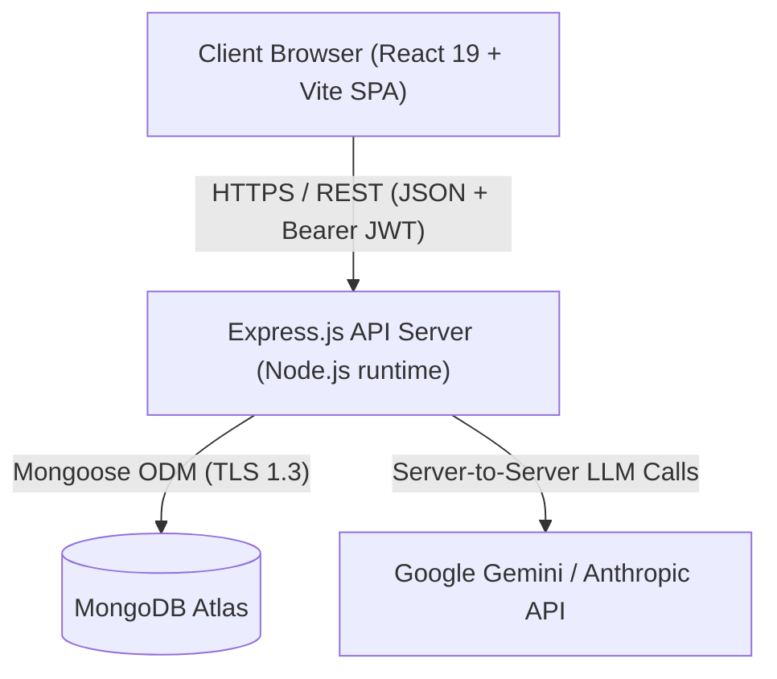
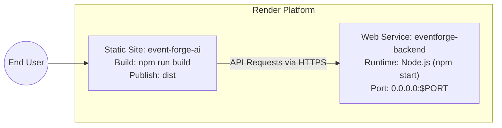

# EventForge System Architecture

EventForge is a production-grade MERN (MongoDB, Express, React, Node.js) web application designed for intelligent event planning, interactive coordination, and AI-driven creative synthesis.

---

## 1. High-Level Architecture

The system operates as a decoupled dual-service topology deployed on Render:
- **Frontend:** Single Page Application (SPA) built with React 19 and Vite, styled via a modular vanilla CSS design system and hosted on Render Static Site.
- **Backend:** REST API server built with Node.js and Express, connected to MongoDB Atlas for persistence and Google Gemini / Anthropic SDKs for generative AI.



---

## 2. Backend Architecture

The backend follows a strict layered separation of concerns:

```
src/
├── app.js                   # Application factory, middleware pipeline & security headers
├── server.js                # Process entry point, port binding & graceful shutdown
├── config/                  # Validated environment settings (env.js) & database connection
├── constants/               # HTTP status codes, event types, error messages
├── controllers/             # HTTP boundary: request parsing, response formatting
├── middlewares/             # Auth (JWT), Rate limiting, NoSQL sanitization, error handler
├── models/                  # Mongoose data models (User, Event, ChatHistory)
├── routes/                  # Express route declarations (auth, events, chat)
├── services/                # Core business logic, deterministic planning engine, AI studio
└── utils/                   # SVG sanitization, validation helpers, formatting
```

### 2.1 Layer Responsibilities

1. **Routing & Dispatch (`src/routes/`):**
   - Declares URL mappings and applies route-specific middlewares (e.g. `protect` for JWT validation, `aiLimiter` for compute-heavy endpoints).
2. **Controller Layer (`src/controllers/`):**
   - Receives Express `req`/`res`, unwraps parameters, delegates to service functions, and formats HTTP responses using standardized JSON envelopes.
3. **Service Layer (`src/services/`):**
   - **`event.service.js`:** Aggregate Root. Pure single-responsibility service orchestrating event creation, ownership resolution (`getOwnedEvent`), user event listing, deletion, and AI idea generation. Domain operations (tasks, vendors, expenses, guests, schedule, posters) are imported and invoked directly by their respective controllers without middle-man indirection.
   - **`task.service.js`:** Task checklist domain lifecycle (creation, status updates, completion timestamps, plan hydration).
   - **`vendor.service.js`:** Vendor procurement domain (quotations, contacts, booking statuses, plan hydration).
   - **`expense.service.js`:** Financial ledger domain (actual vs estimated budget tracking, payment statuses).
   - **`guest.service.js`:** RSVP and guest attendance domain (individual entries, seating assignments, batch CSV import with limits).
   - **`schedule.service.js`:** Day-of run-sheet domain (chronological event timelines and vendor linking).
   - **`eventMetrics.service.js`:** Live dashboard KPI calculation (budget utilization, booking completion, readiness scoring).
   - **`poster.service.js`:** AI SVG and raster poster design studio (prompt generation, SVG sanitization, poster persistence).
   - **`auth.service.js`:** Handles password hashing via `bcryptjs`, JWT token signing with `HS256`, and user identity verification.
   - **`llm.service.js`:** Interacts with Google Gemini (`gemini-2.5-flash`) or Anthropic SDKs to generate tailored creative concepts and conversational responses.
4. **Data Access Layer (`src/models/`):**
   - Defines Mongoose schemas with validation, defaults, and composite indexes (`{ user: 1, createdAt: -1 }`).

---

## 3. Data Models & Schemas

### 3.1 User Model (`src/models/User.model.js`)
- `name`: String, required, trimmed, max 80 characters.
- `email`: String, required, unique, lowercase, regex-validated.
- `password`: String, hashed via bcrypt with cost factor 12, hidden from queries by default (`select: false`).

### 3.2 Event Model (`src/models/Event.model.js`)
An Event serves as the root aggregate containing structured domain arrays:
- `user`: ObjectId reference to `User` (indexed).
- `type`: Enum (`"wedding"`, `"birthday"`, `"community"`).
- `input`: Snapshot of original user preferences (guest count, budget, setting, priorities).
- `plan`: Deterministically generated plan (summary, timeline, budget allocation).
- `ideas`: AI-generated creative inspirations.
- `tasks`: Interactive sub-documents `{ id, title, phase, dueDate, urgent, status, completedAt, notes, assignedTo, isCustom }`.
- `vendors`: Interactive sub-documents `{ id, name, priority, matchesPriority, bookBy, bookNow, tip, bookingStatus, vendorName, contactPerson, contactEmail, contactPhone, quotationAmount, agreedAmount, paidAmount, notes, documents }`.
- `expenses`: Interactive sub-documents `{ id, title, category, estimatedCost, actualCost, paidAmount, status, dueDate, paidDate, linkedVendorId, linkedTaskId, notes }`.
- `guests`: Interactive sub-documents `{ id, name, email, phone, group, invitationStatus, rsvpStatus, plusOnes, plusOneNames, dietary, tableOrSeating, notes }`.
- `schedule`: Interactive sub-documents `{ id, startTime, endTime, activity, location, responsiblePerson, relatedVendorId, notes, completed }`.
- `posters`: Sub-documents `{ id, title, prompt, style, imageData, createdAt }`.

---

## 4. Security Hardening Architecture

EventForge implements defense-in-depth principles across all layers:

1. **JWT Algorithm Pinning & Secret Enforcement:**
   - Tokens are signed and verified strictly using HMAC-SHA256 (`algorithms: ["HS256"]`).
   - In production (`NODE_ENV === "production"`), default or weak secrets are prohibited at startup.
2. **Stored XSS Prevention (SVG Sanitization):**
   - Vectors rendered in the AI Poster Studio are sanitized using `sanitizeSvg` (`src/utils/sanitizeSvg.js`).
   - Prohibits `<script>`, `<iframe>`, `javascript:` protocols, and inline execution handlers (`onload`, `onerror`).
3. **NoSQL Injection Defense:**
   - Global sanitization middleware (`src/middlewares/mongoSanitize.middleware.js`) strips MongoDB operators (`$` and `.`) from user inputs.
4. **CORS Hardening:**
   - Strictly validates `Origin` against `ALLOWED_ORIGINS` / `CLIENT_ORIGIN`.
   - Explicitly allows methods `GET`, `POST`, `PUT`, `PATCH`, `DELETE`, `OPTIONS`.
5. **Anti Brute-Force Rate Limiting:**
   - Auth endpoints (`/api/auth/login`, `/api/auth/register`): 15 requests / minute.
   - Resource-intensive AI endpoints (`/api/events/:id/posters/generate`, `/api/events/:id/generate-ideas`): 10 requests / minute.
6. **Bounded Batch Ingestion:**
   - Guest CSV import is restricted to 500 rows per request and a maximum of 5,000 guests per event.

---

## 5. Frontend Architecture

### 5.1 Technology Stack
- **Framework:** React 19 with Vite.
- **Routing:** React Router v7.
- **Icons:** `lucide-react`.
- **State Management:** React Context (`AuthContext`, `ChatContext`) with local component state.

### 5.2 Modular CSS Architecture
The styling system is decoupled into modular layers located in `frontend/src/styles/`:
- `tokens.css`: Core design tokens, Dark Midnight Theme, and French Linen Beige variables.
- `base.css`: CSS reset, typography base, layout shell, and container definitions.
- `components.css`: Reusable UI components (buttons, badges, cards, form inputs, modals, KPI tiles).
- `chatbot.css`: Luxury glassmorphic chat widget, floating action button, and message formatting.
- `event.css`: Interactive management modules (Preparation Dashboard, Tasks, Vendors, Budget, Guests, Run Sheet, Poster Studio).
- `themes.css`: WCAG AAA accessible high-contrast light theme overrides, print media queries, and responsive breakpoints.

All modules are aggregated into `frontend/src/index.css` via `@import` rules, compiling to a lightweight, unified stylesheet at build time.

---

## 6. Deployment Topology on Render



### 6.1 Port Binding
The backend server dynamically listens on `process.env.PORT` bound to `0.0.0.0`, allowing Render's load balancer to perform automated port discovery and health checking.

### 6.2 Key Environment Variables
- `PORT`: Service port provided dynamically by Render (e.g. 10000).
- `NODE_ENV`: Set to `production`.
- `MONGODB_URI`: MongoDB Atlas connection string.
- `JWT_SECRET`: High-entropy secret key for token signing.
- `CORS_ORIGIN`: Comma-separated list of allowed frontend origins (e.g. `https://event-forge-ai.onrender.com`).
- `GEMINI_API_KEY`: API credential for generative AI features.
